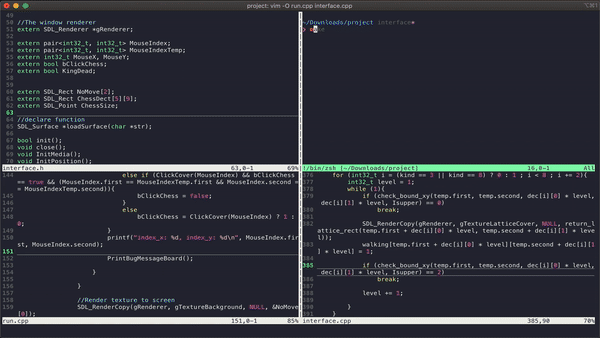

# Pioneer — a Minishogi (5五將棋) engine

Minishogi is shogi on a 5x5 board: six piece types, drops, promotion, and a
branching factor that makes it a genuinely hard game squeezed into 25 squares.
Pioneer began as a 2020–2021 undergraduate capstone at NTNU CSIE (advisor:
Prof. Shun-Shii Lin) and was fielded at the TCGA 2021 computer game
tournament. It is being rebuilt as a verified engine with a rated arena.



## What is here

```
engine/   the current engine: rules, USI protocol, agents
legacy/   the original 2021 program and SDL GUI, still playable
image/    board and piece bitmaps used by the GUI
docs/     roadmap, verification method, the original write-up
```

The engine core is complete and verified: full minishogi rules including
drops, optional promotion, nifu, uchifuzume and the fourth-repetition loss,
with move generation cross-checked against an independent implementation
(see [docs/verification.md](docs/verification.md)). Search is next — the
current agent plays at random, which is the baseline everything else will be
measured against, not a claim of strength.

The legacy GUI still runs, and remains the only way to play with a mouse.
Its agent does not actually search; [legacy/README.md](legacy/README.md)
documents why, since that finding is what motivated the rewrite.

## Building

Requires a C++17 compiler. The engine has no dependencies; the legacy GUI
needs SDL2.

```sh
cd engine && make          # runs the test suite, builds ./pioneer and tools/perft
```

```sh
brew install sdl2          # macOS; Debian/Ubuntu: apt install libsdl2-dev
cd legacy && make run      # the original GUI
```

## Using the engine

`pioneer` speaks [USI](http://hgm.nubati.net/usi.html), so any USI GUI or
match runner can drive it.

```
$ ./pioneer
usi
id name Pioneer
id author Yu-Chen Lin
usiok
position startpos moves 5d5c 1b1c
d
  5 4 3 2 1
a r b s g k
b . . . . .
c P . . . p
d . . . . .
e K G S B R
black to move, ply 3
go
bestmove 4e4d
```

Beyond USI it also accepts `d` (show the board), `moves` (list legal moves),
`sfen` (print the position) and `go perft N`.

```sh
tools/perft 6                            # node counts, start position
tools/perft 5 "4k/5/5/5/K4 b RBGSP 1"    # any position
tools/perft 3 --divide                   # per-move breakdown
```

## Playing the legacy GUI

On startup it asks for a game record to replay (`N` for none), how many games
to play, the MCTS simulation budget per side, and who plays which colour.
Left-click a piece to see its moves, click a highlighted square to move,
click a captured piece to drop it. `a` starts a new game, `Esc` quits.

## Roadmap

[docs/ROADMAP.md](docs/ROADMAP.md) has the full arc: baseline agents and a
mate solver, then self-play strength work, then a rated arena and an online
ladder where outside agents can compete.

## History

The original Chinese capstone report, including the threat-space MCTS idea
the project set out to explore, is preserved verbatim in
[docs/report-2021_zh.md](docs/report-2021_zh.md), with slides
[here](https://reurl.cc/bnojyl).

## License

BSD 2-Clause. See [LICENSE](LICENSE).
